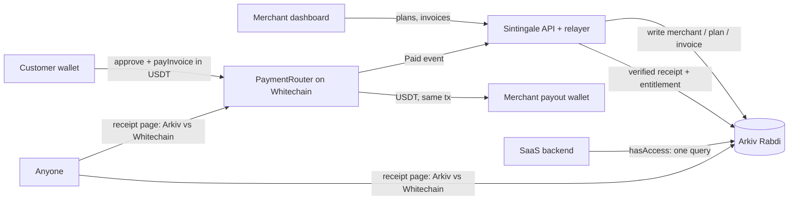

# Sintingale

Stripe-style billing for SaaS, settled in USDT. **Money moves on Whitechain. State lives on Arkiv. Access is a query.**

Merchants create plans and checkout links. Customers pay USDT on Whitechain through a non-custodial
`PaymentRouter`. Every invoice, receipt and entitlement is an attribute-indexed, self-expiring entity on Arkiv.
A SaaS backend checks access with one query.

**Built from scratch at ETHGlobal Mumbai (5–7 November 2026).** The first commit is
[`Add project specification`](https://github.com/crucie/Sintingale/commits/main) on 5 November 2026, 18:04 IST.
The [commit history](https://github.com/crucie/Sintingale/commits/main) and pull requests
[#1–#10](https://github.com/crucie/Sintingale/pulls?q=is%3Apr) show the build step by step.

**Tracks:** Whitechain *Operate · Stablecoin Payments for Business* and Arkiv *Build on Arkiv (from scratch)*.

## Submission at a glance

| | |
|---|---|
| Hosted app (no login) | [sintingale.vercel.app](https://sintingale.vercel.app): merchant at `/dashboard`, customer at `/pay/<key>`, SaaS app at `/demo` |
| Demo video | TODO link (2–4 min: merchant, customer, SaaS backend) |
| `PaymentRouter` (Whitechain Sepolia, verified) | [`0x0d72fafa591e6e5d83db0d6ac6162e38f17c333b`](https://explorer.testnet.whitechain.io/address/0x0d72fafa591e6e5d83db0d6ac6162e38f17c333b) |
| `ProjectSplitter` (Whitechain Sepolia, verified) | [`0xb9e1754493a3f02a60266e486a1ffc7f39042ef6`](https://explorer.testnet.whitechain.io/address/0xb9e1754493a3f02a60266e486a1ffc7f39042ef6) |
| USDT used | [`0xcedfB56113143d55b2358b8CFbB0dEB5Ad2f55a7`](https://explorer.testnet.whitechain.io/token/0xcedfB56113143d55b2358b8CFbB0dEB5Ad2f55a7) (official test USDT, not self-minted) |
| USDT payment settled in the main flow | TODO `https://explorer.testnet.whitechain.io/tx/0x…` |
| Arkiv network | Rabdi testnet, chain `7794095`, [explorer](https://rabdi.explorer.arkiv.network) |
| Wallet that wrote our Arkiv entities | [`0xf9277DD2A25085F868796073A9BF8c0d37F6bb06`](https://rabdi.explorer.arkiv.network/address/0xf9277DD2A25085F868796073A9BF8c0d37F6bb06) (also shown in Dashboard → Settings → Network) |
| Arkiv query to run | See [below](#arkiv-query-you-can-run) |

### Arkiv query you can run

No app server is involved: this reads straight from Rabdi.

```bash
npm install
node scripts/arkiv-query.mjs merchant merchantId=m_sintingale --creator 0xf9277DD2A25085F868796073A9BF8c0d37F6bb06
```

It prints the raw query, so you can also send it through JSON-RPC `arkiv_query`:

```
arkiv.schema = str('sintingale.merchant') AND merchantId = str('m_sintingale') AND $creator = addr(0xf9277DD2A25085F868796073A9BF8c0d37F6bb06)
```

Swap `merchant` for `plan`, `invoice`, `receipt` or `entitlement`. The access check behind `hasAccess()` is
`entitlement merchantId=m_sintingale planId=<plan> customer=0x… "periodEnd>now" --creator 0xf927…bb06`.
More queries are in [`arkiv/schema.md`](./arkiv/schema.md#queries-you-can-run).

**Why this needs onchain stablecoin settlement on Whitechain:**
- The customer's USDT lands in the merchant's own wallet in the same transaction that emits a public `Paid` event
  keyed to the invoice.
- So the merchant, the customer and the merchant's SaaS backend can each verify the payment, and unlock access,
  without trusting Sintingale.
- A card or bank rail can't do this: it holds funds for days, can reverse them through chargebacks, and only gives
  the merchant a private processor record that a third party can't check.
- It also can't take a cross-border payment from a wallet or an AI agent in seconds.

## Prize requirements

### Whitechain: Operate · Stablecoin Payments for Business

| Requirement | Where |
|---|---|
| Contracts on Whitechain Sepolia (1874), verified on the explorer | [`PaymentRouter`](https://explorer.testnet.whitechain.io/address/0x0d72fafa591e6e5d83db0d6ac6162e38f17c333b), [`ProjectSplitter`](https://explorer.testnet.whitechain.io/address/0xb9e1754493a3f02a60266e486a1ffc7f39042ef6), both verified |
| A USDT (`0xcedf…f55a7`) payment settled in the main flow, with the explorer link | TODO tx link in the table above |
| Why this needs onchain stablecoin settlement on Whitechain | [Above](#submission-at-a-glance) |
| Public repo with steady progress; README covers setup, architecture and limitations | [Commits](https://github.com/crucie/Sintingale/commits/main) · [Setup](#setup) · [Architecture](#architecture) · [Limitations](#current-limitations) |
| Demo video, 2–4 min, showing each party | TODO link |
| `WHITECHAIN_FEEDBACK.md` | [`WHITECHAIN_FEEDBACK.md`](./WHITECHAIN_FEEDBACK.md) |

What the track asks to see:

- **A drop-in piece a separate app adds in about 20 lines:** the `Sintingale` SDK, see
  [Integrate in 20 lines](#integrate-in-20-lines). `/demo` is that separate app.
- **Both views:**
  - the merchant: `/dashboard` for plans, invoices, revenue and settings;
  - the paying customer: `/pay/<invoiceKey>`, then `/receipt/<receiptKey>`.
- **Past the first payment:**
  - **renewals:** each payment writes an entitlement that expires at the end of the billing period. Access then lapses
    by itself, and paying a new invoice for the plan renews it. A plan billed "Every 5 minutes" shows this live;
  - **an accountant export:** *Export CSV* on the invoices page (`GET /api/invoices/export`) lists every paid invoice with amount, payer, tx hash, explorer link and Arkiv receipt key.
- **Not a plain transfer:** `PaymentRouter.payInvoice` binds each payment to an invoice id, refuses double payment,
  and emits a `Paid` event the relayer checks against the Arkiv invoice.

### Arkiv: Build on Arkiv (from scratch)

| Requirement | Where |
|---|---|
| Built from scratch at ETHGlobal Mumbai | First commit 5 Nov 2026, [history](https://github.com/crucie/Sintingale/commits/main) |
| Writes to Rabdi with `@arkiv-network/sdk`; a feature users see reads from Arkiv | [`lib/ledger/arkiv.ts`](./lib/ledger/arkiv.ts). Users see Arkiv data in five places: checkout (invoice), receipt page (receipt + `$creator`), `/demo` paywall and `GET /api/access` (entitlement), dashboard (invoices, receipts, stats), products (plans) |
| Writer wallet and one query in the README | [Above](#submission-at-a-glance) |
| `/arkiv/schema.md`, `/arkiv/friction.md` | [`schema.md`](./arkiv/schema.md) · [`friction.md`](./arkiv/friction.md) |
| One file per judging criterion | [`friction.md`](./arkiv/friction.md) · [`reach.md`](./arkiv/reach.md) · [`why-arkiv.md`](./arkiv/why-arkiv.md) · [`how-you-use-arkiv.md`](./arkiv/how-you-use-arkiv.md) |
| Open-source license; how we used AI | [MIT](./LICENSE) · [How we used AI](#how-we-used-ai) |

## Architecture



1. **Checkout.** `/pay/<invoiceKey>` reads the invoice entity from Arkiv. The customer approves USDT and calls
   `PaymentRouter.payInvoice(invoiceId, merchant, token, amount)`. The router pulls the exact amount and forwards it
   to the merchant's registered payout address in the same call. It never holds a balance
   ([`contracts/src/PaymentRouter.sol`](./contracts/src/PaymentRouter.sol)).
2. **Relayer.** The checkout posts the tx hash to `/api/payments/notify`. The relayer reads the `Paid` event and checks
   invoice id, amount, token and merchant against the Arkiv invoice. Only then does it write a `receipt` and an
   `entitlement` ([`lib/relayer.ts`](./lib/relayer.ts)). `/api/relayer/tick` is a cron backstop that scans logs.
3. **Access.** `hasAccess()` is one Arkiv query: `entitlement` by merchant, plan and customer, with `periodEnd > now`,
   created by the relayer. The entitlement expires at the end of the billing period, so access ends without a cron.
4. **Verification.** `/receipt/<receiptKey>` checks the Arkiv receipt's `$creator` and matches it to the `Paid` event on
   Whitechain.
5. **Teams (optional).** ENS-verified orgs, project revenue splits through `ProjectSplitter` (pull-based claims), and
   time-boxed agent grants. Off by default. Nothing in the main flow depends on it.

## Setup

Sintingale has one mode: Arkiv is the database and Whitechain settles every payment. There is no seeded data, no
simulated checkout and no fallback secret. Until the required variables in [`.env.example`](./.env.example) are set,
every API returns `503 NOT_CONFIGURED` and lists what is missing.

You need:

- **Merchant/deployer wallet** with test WBT from [faucet.testnet.whitechain.io](https://faucet.testnet.whitechain.io).
- **Customer wallet** with WBT and test USDT (`0xcedf…f55a7`).
- **Arkiv writer wallet** with tGLM from [hub.arkiv.network/faucet](https://hub.arkiv.network/faucet), and an
  access key from [hub.arkiv.network/access-keys](https://hub.arkiv.network/access-keys).
- **[Foundry](https://getfoundry.sh)** to build and verify the contracts.

```bash
cp .env.example .env               # fill in every required value (generate secrets with: openssl rand -hex 32)

npm install
cd contracts && forge build && forge test && cd ..
node --env-file=.env scripts/deploy.mjs   # deploys PaymentRouter + ProjectSplitter, writes deployments.json
# run the two `forge verify-contract … --verifier blockscout` commands it prints, from contracts/
npm run build && npm start
```

Put the printed contract addresses in `.env` before building. Then:

1. **Merchant: create the merchant.** Go to Dashboard → Settings and connect the merchant wallet. The first time,
   the form writes the merchant entity to Arkiv. The live deployment's `m_sintingale` merchant already exists.
2. **Merchant: register on the router.** Click **Register payout on PaymentRouter** from the same wallet you saved
   as "Merchant wallet".
3. **Merchant: add plans** on the Products page. The example app at `/demo` sells whatever plans exist.
4. **Merchant: create an invoice.** Go to Dashboard → Invoices → New and copy the checkout link.
5. **Customer: pay.** Open the link, approve and pay. The success screen links the Whitechain tx and the Arkiv
   receipt.
6. **Check the result.** The receipt page shows "verified". `/demo` unlocks for the paying wallet, and so does
   `GET /api/access`.

### Hosting on Vercel

1. Import the repo at [vercel.com/new](https://vercel.com/new). Vercel detects Next.js; keep the defaults.
2. Add the environment variables before the first deploy:
   - **Required:** every `NEXT_PUBLIC_*` value from `.env.example`, plus `ARKIV_ACCESS_KEY`, `ARKIV_PRIVATE_KEY`,
     `SINTINGALE_API_KEY` (16+ characters), `SESSION_SECRET` (32+ characters), `CRON_SECRET` and
     `SPLITTER_ALLOWED_TOKEN`.
   - **Your URL:** set `NEXT_PUBLIC_APP_URL` and `SIWE_DOMAIN` to the deployment URL.
   - **Leave out** `DEPLOYER_PRIVATE_KEY`.
3. [`vercel.json`](./vercel.json) schedules the relayer backstop (`/api/relayer/tick`) once a day. Vercel Cron
   authenticates with `CRON_SECRET`.
4. Redeploy after changing any `NEXT_PUBLIC_*` value. They are built into the app at build time. Server secrets are
   read per request: if one is missing, the app still builds, every API returns `503 NOT_CONFIGURED`, and
   Dashboard → Settings lists the missing variables.

## Routes

| Route | Purpose |
|---|---|
| `/` | Landing page |
| `/dashboard` | Revenue, paid/pending counts, active entitlements, recent activity |
| `/dashboard/products` | Create and list plans, with a live checkout preview |
| `/dashboard/invoices` | Paid / pending / expired invoices, with *Export CSV* for the accountant |
| `/dashboard/invoices/new` | Create an invoice, get a link and QR code |
| `/dashboard/settings` | Merchant setup and profile, payout registration, API key, network info |
| `/pay/[invoiceKey]` | Mobile-first customer checkout |
| `/receipt/[receiptKey]` | Public receipt with Arkiv vs. Whitechain verification |
| `/demo` | Paywalled sample SaaS app using `hasAccess()` |
| `/dashboard/org`, `/dashboard/org/connect` | Teams & ENS: org overview and ENS ownership proof |
| `/dashboard/team`, `/dashboard/team/invite` | Teams & ENS: members, expiring invites, approvals |
| `/invite/[inviteKey]` | Teams & ENS: public invitee landing |
| `/dashboard/projects`, `/dashboard/projects/[id]`, `…/shares` | Teams & ENS: projects, payouts, contribution-based share editor |
| `/dashboard/agents` | Teams & ENS: agent grants with live expiry |
| `/me/earnings` | Teams & ENS: a member's claimable balances and payout history |

## API

| Method | Route | Auth |
|---|---|---|
| `POST` | `/api/setup` | Dashboard (same-origin) or API key |
| `GET/POST` | `/api/merchants` | Dashboard or API key |
| `GET/POST` | `/api/plans` | Dashboard or API key |
| `GET/POST` | `/api/invoices` | Dashboard or API key |
| `GET` | `/api/invoices/export?merchantId=` | Dashboard or API key. CSV of paid invoices for accounting |
| `GET` | `/api/invoices/:key` | Public |
| `POST` | `/api/payments/notify` | Public, rate-limited |
| `GET` | `/api/access?merchantId=&planId=&customer=` | API key (`x-api-key`) |
| `GET` | `/api/verify/:receiptKey` | Public, rate-limited |
| `GET` | `/api/stats` | Dashboard or API key |
| `GET` | `/api/relayer/tick` | `CRON_SECRET` bearer, if set |
| `GET/POST/DELETE` | `/api/auth/nonce`, `/api/auth/verify`, `/api/auth/session` | Sign-In with Ethereum (EIP-4361), single-use nonces |
| `POST` | `/api/orgs` | Signed-in wallet that controls the ENS name |
| `GET/POST` | `/api/projects`, `PUT/POST /api/projects/:id/shares` | Org owner |
| `GET` | `/api/projects/:id/payouts` | Public (relayer-written payouts only) |
| `GET/POST` | `/api/invites`, `GET /api/invites/:key`, `POST /api/invites/:key/accept` | Org owner / public / invitee signature |
| `GET/POST` | `/api/members`, `POST /api/members/:label/issue-subname` | Org owner |
| `GET/POST` | `/api/grants`, `POST /api/revocations` | Org owner |
| `GET` / `POST` | `/api/me/claimable`, `/api/me/claim` | Signed-in wallet |
| `POST` | `/api/invoices` with `x-sintingale-agent` headers | Agent: ENS name + signature + unexpired grant |

All Teams & ENS routes return `403 FEATURE_DISABLED` until the feature is turned on in Settings.

Errors use `{ "error": { "code": "INVOICE_EXPIRED", "message": "…" } }`.

## Integrate in 20 lines

A separate SaaS backend adds Sintingale with the SDK in [`lib/sdk/index.ts`](./lib/sdk/index.ts). It is one file
with no runtime dependencies: copy it, or call the REST API directly. This is a complete paywall for an Express
app:

```ts
import express from "express";
import { Sintingale } from "./sintingale-sdk";

const app = express();
const gp = new Sintingale({ baseUrl: "https://sintingale.vercel.app", apiKey: process.env.SINTINGALE_API_KEY! });
const merchantId = "m_sintingale";

// Gate: one Arkiv query decides access (entitlement for this wallet and plan, still inside its period).
app.get("/pro", async (req, res) => {
  const wallet = String(req.query.wallet);
  if (await gp.hasAccess({ merchantId, planId: "pro", customer: wallet })) return res.send("Welcome to Pro");
  // No access yet: create a USDT invoice for this wallet and send the customer to checkout.
  const { checkoutUrl } = await gp.createInvoice({ merchantId, planId: "pro", customer: wallet, dueInHours: 1 });
  res.redirect(checkoutUrl);
});

app.listen(3001);
```

After the customer pays on Whitechain, the relayer writes the entitlement to Arkiv, and the same `/pro` request
lets them in. [`app/demo`](./app/demo) is this flow inside Next.js.

## Teams & ENS (optional, off by default)

> Sintingale turns a company's ENS name into its billing organization: customers pay `acme.eth`, teammates and agents
> are subnames, and every split, invite and permission is an expiring, queryable record.

Turn it on in **Dashboard → Settings → Teams & ENS**. While it is off, team pages and APIs are disabled, project
invoices are hidden, and checkout never looks up ENS. Payments, invoices and receipts work the same either way.

- **ENS identity (Ethereum Sepolia, reads only).** Link a name by proving control: its ETH address is your wallet, or
  a `sintingale.owner` text record names it. Checkout then shows "Paying acme.eth ✓" and blocks payment if the name
  stops resolving to the recorded payout. Sepolia runs ENSv2, so Sintingale verifies names rather than issuing them;
  see [`docs/VERIFICATION.md`](./docs/VERIFICATION.md).
- **Teams.** Invites are 48-hour expiring entities. The owner creates the member's subname in the ENS app, and
  Sintingale approves it only once it resolves to the member's wallet.
- **Revenue splits.** Each member's **contribution** to a project sets their share (basis points, always exactly
  100%). Project invoices pay [`ProjectSplitter`](./contracts/src/ProjectSplitter.sol), which credits claimable
  balances: pull payments, rounding dust to the owner, shares changes only affect later payments. Members claim from
  `/me/earnings`.
- **Agents.** An agent is a subname plus an expiring, capped `grant`. Signed agent requests are checked for name,
  signer, scope, per-invoice cap and total cap (`AGENT_NAME_MISMATCH`, `SCOPE_DENIED`, `CAP_EXCEEDED`,
  `GRANT_EXPIRED`, …). Try it with `npm run agent` (see [`scripts/agent-request.ts`](./scripts/agent-request.ts)).
- **Trust.** Org entities are written by the relayer but carry the owner's wallet signature over their attributes;
  `isValidOrgEntity()` ([`lib/arkiv/trust.ts`](./lib/arkiv/trust.ts)) ignores anything that isn't owner-written or
  owner-signed. Receipts, payouts and claims must come from the relayer.

**Set up a real org from the terminal:** `OWNER_PRIVATE_KEY=0x… ENS_NAME=yourname.eth npm run seed` links the name and
creates a project; set its shares in the dashboard (an on-chain `createProject`). Wallets and faucets:
[`scripts/fund.md`](./scripts/fund.md).

**Walkthrough:** link the name → project "Launch" with contributions 5 / 3 / 2 → invite alice, accept in a
second browser profile, issue `alice.<name>` in the ENS app, approve → invoice 10 USDT on the project and pay as a
customer without ENS → three payouts of 5.00 / 3.00 / 2.00 → alice claims 3.00 → create a 1-hour, 25 USDT agent grant
and invoice as the agent, then over the cap → let a short invite and grant lapse.

## Tests

```bash
npm test                 # unit tests: trust filtering, bps and contribution math, address diff, grant caps, nonces
npm run test:contracts   # Foundry: ProjectSplitter (14 tests incl. fuzzed "credits always sum to the amount")
```

## Current limitations

- **ENS is resolved off-chain.** The splitter pays addresses captured when shares were saved. If a member's name
  moves, the project page flags it and the owner re-saves the share table.
- **Subnames are not locked** (no fuses burned). The org owner can remove or replace them; this is intentional.
- **Share changes are forward-looking only.** Past payouts are never recalculated.

- **The relayer is one trusted writer.** It writes every Arkiv entity (`$creator` and `$owner`). Receipts are
  cross-checked against Whitechain, but merchants don't yet write their own plans and invoices from their wallet.
- **Merchant routes use same-origin checks** rather than wallet-signature auth. Team features do use SIWE.
- **The customer pays gas in WBT.** Sponsored (gasless) checkout, recurring `permit` pulls and refunds are not
  implemented yet.
- **Expired invoices** disappear from Arkiv queries, so the dashboard's "Expired" list is remembered per browser.
- **Plain-text emails.** The merchant billing email and invoice customer emails are stored in plain text on Arkiv.
  Use test data only.
- **Per-instance memory.** The relayer's log cursor, rate limits and the used-nonce set are kept per server instance.
  All business data is on Arkiv, so this only affects replay windows and the backstop's starting block.
- **180-day lifetime cap.** Rabdi's maximum entity lifetime is about 182 days, so every entity is capped at 180.
  Merchants and plans need a refresh within that window, and a yearly plan's entitlement ends at 180 days.
- **No refunds or recurring pulls yet.** Renewal means paying a new invoice. `permit`-based pulls and one-click
  refunds are next.

## Build timeline

All times are IST, taken from the [commit history](https://github.com/crucie/Sintingale/commits/main). There are 91
commits: 16 on 5 November, 48 on 6 November and 27 on 7 November.

| When | What | Pull request |
|---|---|---|
| 5 Nov, 18:04–20:06 | Spec, Next.js scaffold, design tokens, `PaymentRouter` contract | [#1](https://github.com/crucie/Sintingale/pull/1) |
| 5 Nov, 20:24–22:31 | Config, Whitechain chain and ABIs, entity schema, shared types | [#2](https://github.com/crucie/Sintingale/pull/2) |
| 5 Nov, 22:46 – 6 Nov, 01:22 | Ledger interface and the Arkiv SDK backend | [#3](https://github.com/crucie/Sintingale/pull/3) |
| 6 Nov, 09:34–13:34 | API, relayer (`Paid` event verification), access check, SDK | [#4](https://github.com/crucie/Sintingale/pull/4) |
| 6 Nov, 14:05–16:01 | UI kit, wallet connect, network guard | [#5](https://github.com/crucie/Sintingale/pull/5) |
| 6 Nov, 16:14–19:40 | Merchant dashboard: products, invoices, settings | [#6](https://github.com/crucie/Sintingale/pull/6) |
| 6 Nov, 19:58–21:36 | Customer checkout and public receipt verification | [#7](https://github.com/crucie/Sintingale/pull/7) |
| 6 Nov, 21:49–22:15 | Paywalled example SaaS app | [#8](https://github.com/crucie/Sintingale/pull/8) |
| 6 Nov, 22:28 – 7 Nov, 00:34 | Landing page, first README | [#9](https://github.com/crucie/Sintingale/pull/9) |
| 7 Nov, 08:55–10:07 | Teams & ENS, `ProjectSplitter`, agent grants, tests, deploy scripts, sponsor docs. Contracts deployed and verified on Whitechain Sepolia at 09:42. | [#10](https://github.com/crucie/Sintingale/pull/10) |
| 7 Nov, 11:10–11:56 | First live runs against Arkiv, which surfaced the `str` size and lifetime limits now in [`arkiv/friction.md`](./arkiv/friction.md); CSV export; production hardening (Arkiv and Whitechain required, demo data removed) | direct to `main` |

The Teams & ENS work in #10 was built overnight and committed in the morning of 7 November as nine separate commits.

## How we used AI

We used AI coding agents in Cursor throughout the hackathon, as ETHGlobal's rules require us to disclose:

- **Code:** scaffolding UI components and API routes, the Teams & ENS feature, unit and Foundry tests, the deploy
  and Arkiv query scripts, the first-run merchant setup and the CSV export.
- **Debugging:** finding the two Arkiv issues described in [`arkiv/friction.md`](./arkiv/friction.md) by running against
  the live network.
- **Research:** checking contract addresses, RPCs and limits against the Whitechain and Arkiv docs, and against the
  chains themselves.
- **Docs:** drafting this README, the `arkiv/` files and `WHITECHAIN_FEEDBACK.md`.

The product idea, architecture, data model and judging-facing claims are ours. Every change was reviewed and run by
the team before merging, through the pull requests linked above.

## License

[MIT](./LICENSE)
