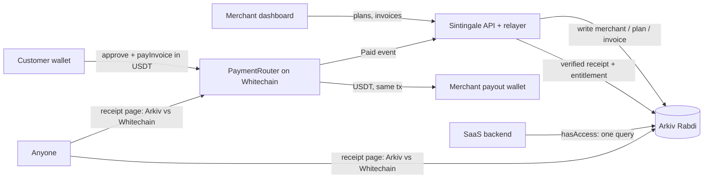

# Sintingale

Stripe-style billing for SaaS, settled in USDT. **Money moves on Whitechain. State lives on Arkiv. Access is a query.**

Merchants create plans and checkout links. Customers pay USDT on Whitechain through a non-custodial
`PaymentRouter`. Every invoice, receipt and entitlement is an attribute-indexed, self-expiring entity on Arkiv.
A SaaS backend checks access with one query. Built from scratch at ETHGlobal Mumbai (5–7 November 2026).

## Submission at a glance

| | |
|---|---|
| `PaymentRouter` (Whitechain Sepolia, verified) | TODO `https://explorer.testnet.whitechain.io/address/0x…` |
| `ProjectSplitter` (Whitechain Sepolia, verified) | TODO `https://explorer.testnet.whitechain.io/address/0x…` |
| USDT used | [`0xcedfB56113143d55b2358b8CFbB0dEB5Ad2f55a7`](https://explorer.testnet.whitechain.io/token/0xcedfB56113143d55b2358b8CFbB0dEB5Ad2f55a7) |
| USDT payment settled in the main flow | TODO `https://explorer.testnet.whitechain.io/tx/0x…` |
| Arkiv writer wallet (Rabdi) | TODO `0x…` (the `ARKIV_PRIVATE_KEY` address, shown in Dashboard → Settings → Network) |
| Arkiv query to run | `node scripts/arkiv-query.mjs receipt merchantId=m_demo --creator <writer>` ([more](./arkiv/schema.md#queries-you-can-run)) |
| Demo video | TODO link |
| Hosted app | TODO link |

**Why this needs onchain stablecoin settlement on Whitechain:**
- The customer's USDT lands in the merchant's own wallet in the same transaction that emits a public `Paid` event
  keyed to the invoice.
- So the merchant, the customer and the merchant's SaaS backend can each verify the payment, and unlock access,
  without trusting Sintingale.
- A card or bank rail can't do this: it holds funds for days, can reverse them through chargebacks, and only gives
  the merchant a private processor record that a third party can't check.
- It also can't take a cross-border payment from a wallet or an AI agent in seconds.

Sponsor docs: [`WHITECHAIN_FEEDBACK.md`](./WHITECHAIN_FEEDBACK.md) ·
[`arkiv/schema.md`](./arkiv/schema.md) · [`arkiv/friction.md`](./arkiv/friction.md) ·
[`arkiv/reach.md`](./arkiv/reach.md) · [`arkiv/why-arkiv.md`](./arkiv/why-arkiv.md) ·
[`arkiv/how-you-use-arkiv.md`](./arkiv/how-you-use-arkiv.md)

## Architecture



1. **Checkout.** `/pay/<invoiceKey>` reads the invoice entity from Arkiv. The customer approves USDT and calls
   `PaymentRouter.payInvoice(invoiceId, merchant, token, amount)`. The router pulls the exact amount and forwards it
   to the merchant's registered payout address in the same call. It never holds a balance
   ([`contracts/src/PaymentRouter.sol`](./contracts/src/PaymentRouter.sol)).
2. **Relayer.** The checkout posts the tx hash to `/api/payments/notify`. The relayer reads the `Paid` event and checks
   invoice id, amount, token and merchant against the Arkiv invoice. Only then does it write a `receipt` and an
   `entitlement` ([`lib/relayer.ts`](./lib/relayer.ts)). `/api/relayer/tick` is a cron backstop that scans logs.
3. **Access.** `hasAccess()` is one Arkiv query: `entitlement` by merchant, plan and customer, with `periodEnd > now`,
   created by the relayer. The entitlement expires at the end of the billing period, so access ends without a cron.
4. **Verification.** `/receipt/<receiptKey>` checks the Arkiv receipt's `$creator` and matches it to the `Paid` event on
   Whitechain.
5. **Teams (optional).** ENS-verified orgs, project revenue splits through `ProjectSplitter` (pull-based claims), and
   time-boxed agent grants. Off by default. Nothing in the main flow depends on it.

## Setup

### Demo mode (no keys)

```bash
npm install
npm run dev
```

Open http://localhost:3000. With no environment variables, the app uses an in-process emulation of Arkiv seeded
with a demo merchant, and checkout runs a clearly labelled simulation.

### Testnet mode (Whitechain Sepolia + Arkiv Rabdi)

You need:

- **Merchant/deployer wallet** with test WBT from [faucet.testnet.whitechain.io](https://faucet.testnet.whitechain.io).
- **Customer wallet** with WBT and test USDT (`0xcedf…f55a7`).
- **Arkiv writer wallet** with tGLM from [hub.arkiv.network/faucet](https://hub.arkiv.network/faucet), and an
  access key from [hub.arkiv.network/access-keys](https://hub.arkiv.network/access-keys).
- **[Foundry](https://getfoundry.sh)** to build and verify the contracts.

```bash
cp .env.example .env               # then fill in DEPLOYER_PRIVATE_KEY, ARKIV_* and SESSION_SECRET

cd contracts && forge build && forge test && cd ..
node --env-file=.env scripts/deploy.mjs   # deploys PaymentRouter + ProjectSplitter, writes deployments.json
# run the two `forge verify-contract … --verifier blockscout` commands it prints, from contracts/
```

Put the printed addresses in `.env`, set `ARKIV_ENABLED=true`, then run `npm run dev` and:

1. **Merchant: create the merchant.** Go to Dashboard → Settings and connect the merchant wallet. On an empty
   ledger, the form creates the merchant and the demo plans.
2. **Merchant: register on the router.** Click **Register payout on PaymentRouter** from the same wallet you saved
   as "Merchant wallet".
3. **Merchant: create an invoice.** Go to Dashboard → Invoices → New and copy the checkout link.
4. **Customer: pay.** Open the link, approve and pay. The success screen links the Whitechain tx and the Arkiv
   receipt.
5. **Check the result.** The receipt page shows "verified". `/demo` unlocks for the paying wallet, and so does
   `GET /api/access`.

## Routes

| Route | Purpose |
|---|---|
| `/` | Landing page |
| `/dashboard` | Revenue, paid/pending counts, active entitlements, recent activity |
| `/dashboard/products` | Create and list plans, with a live checkout preview |
| `/dashboard/invoices` | Paid / pending / expired invoices |
| `/dashboard/invoices/new` | Create an invoice, get a link and QR code |
| `/dashboard/settings` | Merchant setup and profile, payout registration, API key, network info |
| `/pay/[invoiceKey]` | Mobile-first customer checkout |
| `/receipt/[receiptKey]` | Public receipt with Arkiv vs. Whitechain verification |
| `/demo` | Paywalled sample SaaS app using `hasAccess()` |
| `/dashboard/org`, `/dashboard/org/connect` | Teams & ENS: org overview and ENS ownership proof |
| `/dashboard/team`, `/dashboard/team/invite` | Teams & ENS: members, expiring invites, approvals |
| `/invite/[inviteKey]` | Teams & ENS: public invitee landing |
| `/dashboard/projects`, `/dashboard/projects/[id]`, `…/shares` | Teams & ENS: projects, payouts, contribution-based share editor |
| `/dashboard/agents` | Teams & ENS: agent grants with live expiry |
| `/me/earnings` | Teams & ENS: a member's claimable balances and payout history |

## API

| Method | Route | Auth |
|---|---|---|
| `POST` | `/api/setup` | Dashboard (same-origin) or API key |
| `GET/POST` | `/api/merchants` | Dashboard or API key |
| `GET/POST` | `/api/plans` | Dashboard or API key |
| `GET/POST` | `/api/invoices` | Dashboard or API key |
| `GET` | `/api/invoices/:key` | Public |
| `POST` | `/api/payments/notify` | Public, rate-limited |
| `GET` | `/api/access?merchantId=&planId=&customer=` | API key (`x-api-key`) |
| `GET` | `/api/verify/:receiptKey` | Public, rate-limited |
| `GET` | `/api/stats` | Dashboard or API key |
| `GET` | `/api/relayer/tick` | `CRON_SECRET` bearer, if set |
| `GET/POST/DELETE` | `/api/auth/nonce`, `/api/auth/verify`, `/api/auth/session` | Sign-In with Ethereum (EIP-4361), single-use nonces |
| `POST` | `/api/orgs` | Signed-in wallet that controls the ENS name |
| `GET/POST` | `/api/projects`, `PUT/POST /api/projects/:id/shares` | Org owner |
| `GET` | `/api/projects/:id/payouts` | Public (relayer-written payouts only) |
| `GET/POST` | `/api/invites`, `GET /api/invites/:key`, `POST /api/invites/:key/accept` | Org owner / public / invitee signature |
| `GET/POST` | `/api/members`, `POST /api/members/:label/issue-subname` | Org owner |
| `GET/POST` | `/api/grants`, `POST /api/revocations` | Org owner |
| `GET` / `POST` | `/api/me/claimable`, `/api/me/claim` | Signed-in wallet |
| `POST` | `/api/invoices` with `x-sintingale-agent` headers | Agent: ENS name + signature + unexpired grant |

All Teams & ENS routes return `403 FEATURE_DISABLED` until the feature is turned on in Settings.

Errors use `{ "error": { "code": "INVOICE_EXPIRED", "message": "…" } }`.

```ts
import { Sintingale } from "@/lib/sdk";

const gp = new Sintingale({ baseUrl: "https://sintingale.app", apiKey: process.env.SINTINGALE_API_KEY! });
const active = await gp.hasAccess({ merchantId: "m_demo", planId: "pro", customer: "0x…" });
```

## Teams & ENS (optional, off by default)

> Sintingale turns a company's ENS name into its billing organization: customers pay `acme.eth`, teammates and agents
> are subnames, and every split, invite and permission is an expiring, queryable record.

Turn it on in **Dashboard → Settings → Teams & ENS**. While it is off, team pages and APIs are disabled, project
invoices are hidden, and checkout never looks up ENS. Payments, invoices and receipts work the same either way.

- **ENS identity (Ethereum Sepolia, reads only).** Link a name by proving control: its ETH address is your wallet, or
  a `sintingale.owner` text record names it. Checkout then shows "Paying acme.eth ✓" and blocks payment if the name
  stops resolving to the recorded payout. Sepolia runs ENSv2, so Sintingale verifies names rather than issuing them;
  see [`docs/VERIFICATION.md`](./docs/VERIFICATION.md).
- **Teams.** Invites are 48-hour expiring entities. The owner creates the member's subname in the ENS app, and
  Sintingale approves it only once it resolves to the member's wallet.
- **Revenue splits.** Each member's **contribution** to a project sets their share (basis points, always exactly
  100%). Project invoices pay [`ProjectSplitter`](./contracts/src/ProjectSplitter.sol), which credits claimable
  balances: pull payments, rounding dust to the owner, shares changes only affect later payments. Members claim from
  `/me/earnings`.
- **Agents.** An agent is a subname plus an expiring, capped `grant`. Signed agent requests are checked for name,
  signer, scope, per-invoice cap and total cap (`AGENT_NAME_MISMATCH`, `SCOPE_DENIED`, `CAP_EXCEEDED`,
  `GRANT_EXPIRED`, …). Try it with `npm run agent` (see [`scripts/agent-request.ts`](./scripts/agent-request.ts)).
- **Trust.** Org entities are written by the relayer but carry the owner's wallet signature over their attributes;
  `isValidOrgEntity()` ([`lib/arkiv/trust.ts`](./lib/arkiv/trust.ts)) ignores anything that isn't owner-written or
  owner-signed. Receipts, payouts and claims must come from the relayer.

**Try it without a Sepolia name:** on the in-memory ledger, Settings → enable Teams & ENS, then sign in as a seeded
`.demo` identity (owner of `acme.demo`, alice, bob or carol). `.demo` is not an ENS TLD, so these can never be
mistaken for real names.

**Seed a real org:** `OWNER_PRIVATE_KEY=0x… ENS_NAME=yourname.eth npm run seed`. Wallets and faucets:
[`scripts/fund.md`](./scripts/fund.md).

**Demo script (brief 11.2):** link the name → project "Launch" with contributions 5 / 3 / 2 → invite alice, accept in a
second browser profile, issue `alice.<name>` in the ENS app, approve → invoice 10 USDT on the project and pay as a
customer without ENS → three payouts of 5.00 / 3.00 / 2.00 → alice claims 3.00 → create a 1-hour, 25 USDT agent grant
and invoice as the agent, then over the cap → let a short invite and grant lapse.

## Tests

```bash
npm test                 # unit tests: trust filtering, bps and contribution math, address diff, grant caps, nonces
npm run test:contracts   # Foundry: ProjectSplitter (14 tests incl. fuzzed "credits always sum to the amount")
```

## Current limitations

- **ENS is resolved off-chain.** The splitter pays addresses captured when shares were saved. If a member's name
  moves, the project page flags it and the owner re-saves the share table.
- **Subnames are not locked** (no fuses burned). The org owner can remove or replace them; this is intentional.
- **Share changes are forward-looking only.** Past payouts are never recalculated.

- **The relayer is one trusted writer.** It writes every Arkiv entity (`$creator` and `$owner`). Receipts are
  cross-checked against Whitechain, but merchants don't yet write their own plans and invoices from their wallet.
- **Merchant routes use same-origin checks** rather than wallet-signature auth. Team features do use SIWE.
- **The customer pays gas in WBT.** Sponsored (gasless) checkout, recurring `permit` pulls and refunds are not
  implemented yet.
- **Expired invoices** disappear from Arkiv queries, so the dashboard's "Expired" list is remembered per browser.
- **Plain-text emails.** The merchant billing email and invoice customer emails are stored in plain text on Arkiv.
  Use test data only.
- **Process memory.** The demo ledger, relayer log cursor and used-nonce set live in process memory. Use Arkiv mode
  for multi-instance hosting.

## How we used AI

**TODO (team): confirm or edit.** We used AI coding assistants (Cursor's agent) throughout:

- scaffolding UI components and API routes;
- writing contract tests;
- the deploy and Arkiv query scripts;
- reviewing integration details against the Whitechain and Arkiv docs;
- drafting these docs.

Architecture, the data model and product decisions are ours, and every change was reviewed and tested by the team.

## License

[MIT](./LICENSE)
