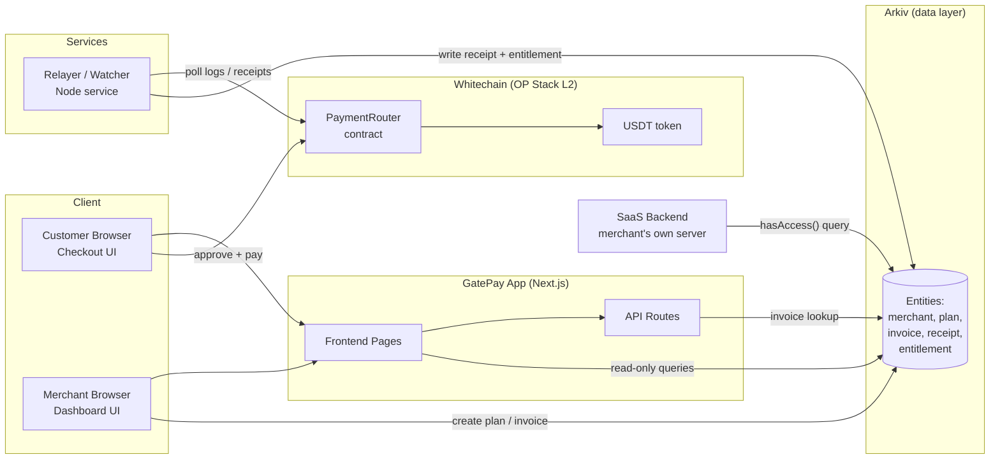
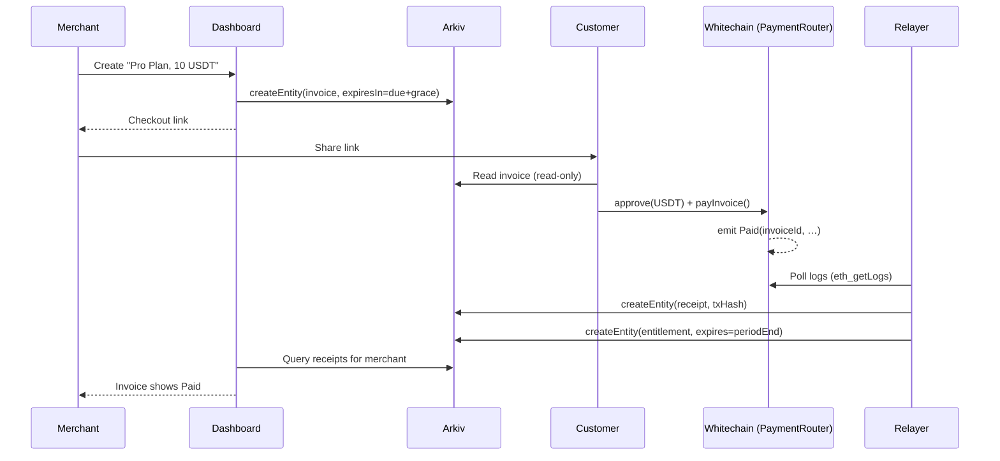
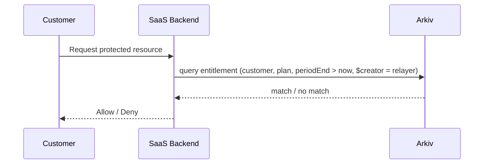
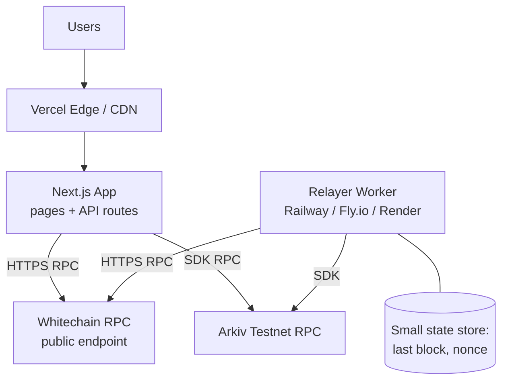

# GatePay — Project Documentation

> **A Stripe-alternative payment gateway for SaaS, powered by Whitechain (settlement) and Arkiv (queryable, expiring billing ledger).**

| | |
|---|---|
| **Project** | GatePay |
| **Event** | ETHGlobal Mumbai |
| **Sponsors targeted** | Whitechain, Arkiv (optional: World ID, Arc) |
| **Document status** | Living document, v1.0 |
| **Target build time** | 2.5–3 h for the core demo; stretch goals fill the remainder of the hackathon |

---

## Table of Contents

1. [Overview](#1-overview)
2. [Goals, Non-Goals and Success Criteria](#2-goals-non-goals-and-success-criteria)
3. [Users and Use Cases](#3-users-and-use-cases)
4. [System Architecture](#4-system-architecture)
5. [Component Specifications](#5-component-specifications)
6. [Data Model (Arkiv)](#6-data-model-arkiv)
7. [Smart Contract Specification (Whitechain)](#7-smart-contract-specification-whitechain)
8. [API Specification](#8-api-specification)
9. [Core Flows](#9-core-flows)
10. [Frontend: Pages, Components and Responsive Structure](#10-frontend-pages-components-and-responsive-structure)
11. [Infrastructure and Deployment](#11-infrastructure-and-deployment)
12. [Security and Trust Model](#12-security-and-trust-model)
13. [Repository Structure](#13-repository-structure)
14. [Milestones and Timeline](#14-milestones-and-timeline)
15. [Testing Strategy](#15-testing-strategy)
16. [Demo Script](#16-demo-script)
17. [Prize Alignment](#17-prize-alignment)
18. [Risks, Assumptions and Open Questions](#18-risks-assumptions-and-open-questions)
19. [Future Roadmap](#19-future-roadmap)
20. [Glossary](#20-glossary)

---

## 1. Overview

### 1.1 One-liner

GatePay is drop-in payment infrastructure that lets SaaS founders create checkout links, invoices and subscription status without Stripe. Customers pay in USDT on Whitechain, and every invoice, receipt and subscription state lives as a queryable, expiring entity on Arkiv.

### 1.2 Problem

Indie, regional and crypto-native SaaS builders struggle with traditional processors:

- High fees and limited or no stablecoin support.
- Regional restrictions and onboarding friction.
- No independently verifiable receipts. The merchant's database is the only source of truth.
- Building custom crypto billing (checkout, invoice tracking, subscription lifecycle) is time-consuming and error-prone.

### 1.3 Solution

GatePay provides:

- A **merchant dashboard** to create products and prices.
- **Checkout links** (and an embeddable flow) for customers.
- **Settlement on Whitechain** in USDT, with a sponsored-gas option so customers do not need the gas token.
- **Arkiv entities** for invoices, receipts and access entitlements, queryable by the merchant or the merchant's own backend with no separate indexer.
- A **one-query access check** for the SaaS backend: "does this customer currently have an active entitlement?"

### 1.4 Key design principle

> **Money moves on Whitechain. State lives on Arkiv. Access is a query.**

An unexpired entitlement entity on Arkiv is what grants access. When a billing period ends, the entity expires on its own, so no cron job or webhook is needed to revoke access.

---

## 2. Goals, Non-Goals and Success Criteria

### 2.1 Goals (hackathon scope)

| # | Goal |
|---|---|
| G1 | A merchant creates a product/price and gets a shareable checkout link. |
| G2 | A customer pays USDT on Whitechain from the checkout page. |
| G3 | Payment results in a queryable record on Arkiv (invoice status plus receipt with tx hash). |
| G4 | The merchant dashboard lists paid and pending invoices by querying Arkiv directly. |
| G5 | Unpaid invoices visibly expire automatically. |
| G6 | A SaaS backend can check access through one Arkiv query. |

### 2.2 Stretch goals

- Gasless / merchant-sponsored payment via a relayer.
- Basic recurring subscriptions with automatic renewal.
- A public receipt verification page that cross-checks Arkiv against Whitechain.
- World ID gate on a high-value plan.
- USDC path via Arc.

### 2.3 Non-goals

- Fiat on/off-ramps, tax handling, refunds and disputes.
- Production-grade key management and multi-tenant isolation.
- Full multi-chain routing.
- Mainnet deployment.

### 2.4 Success criteria

1. End-to-end payment creates a queryable Arkiv entity.
2. The merchant sees invoice status by querying Arkiv, with no private database required for payment state.
3. A clear demo of a founder creating a product and accepting payment without Stripe.

---

## 3. Users and Use Cases

### 3.1 Personas

| Persona | Description | Needs |
|---|---|---|
| **Merchant (SaaS founder)** | Indie developer or small team selling a product | Create prices, share checkout, see who paid, unlock access |
| **Customer** | End user of the SaaS | Simple pay flow, low friction, proof of payment |
| **SaaS backend** | The merchant's server | Programmatic "is this customer active?" check |
| **Auditor / accountant** (secondary) | Reviews billing records | Queryable, verifiable records |

### 3.2 Use cases

- **UC1:** Merchant creates "Pro Plan, 10 USDT" and receives a checkout link.
- **UC2:** Customer opens the link, connects a wallet, pays and sees a success state with the tx hash.
- **UC3:** Merchant dashboard shows the new paid invoice and a list of pending invoices with expiry countdowns.
- **UC4:** An unpaid invoice passes its due date and disappears from the active list automatically.
- **UC5:** The merchant's backend calls `hasAccess(customer, planId)` and gets a boolean.
- **UC6 (stretch):** A subscription renews each period and lapses when payment stops.

---

## 4. System Architecture

### 4.1 High-level diagram



### 4.2 Layers

| Layer | Responsibility | Technology |
|---|---|---|
| **Presentation** | Checkout and dashboard UI, wallet connection | Next.js (or React), Tailwind CSS |
| **Application** | Invoice creation, checkout resolution, relayer orchestration | Next.js API routes, Node relayer |
| **Settlement** | Moving USDT, enforcing payment rules | Whitechain, `PaymentRouter` contract |
| **State / Ledger** | Invoices, receipts, entitlements, expiry, queries | Arkiv SDK (TypeScript) |
| **Identity (optional)** | Human verification | World ID widget |

### 4.3 Why two chains work together

Whitechain and Arkiv are separate networks. GatePay bridges them in **application logic**, not trustlessly at the protocol level:

1. The `PaymentRouter` contract emits a `Paid` event on Whitechain.
2. The relayer observes it and writes a `receipt` entity on Arkiv containing the `txHash`.
3. Anyone can verify a receipt by fetching the Arkiv entity and confirming the matching log on Whitechain (see the Verification page, section 10).

This keeps the claim honest: **Arkiv is the queryable record; Whitechain is the proof of payment.**

---

## 5. Component Specifications

### 5.1 Checkout (customer-facing)

- Resolves an invoice or plan from the checkout URL (`/pay/[invoiceKey]`).
- Reads the invoice entity from Arkiv with a read-only client.
- Connects a wallet, ensures the Whitechain network, performs `approve` (if needed) and `payInvoice`.
- Displays states: `loading → ready → awaiting-wallet → confirming → success | error | expired`.
- On success, shows the tx hash, an explorer link and a receipt link.

### 5.2 Merchant Dashboard

- **Products/Plans:** create name, amount, token, interval (one-time or recurring).
- **Invoices:** create an invoice for a plan or custom amount, with an optional customer wallet or email and due date.
- **Payments:** table of paid and pending invoices, with status, amount, customer, expiry and tx hash.
- **Live updates:** subscribes to new entities via Arkiv event streaming where available, otherwise polls.
- **Checkout link generator:** copy link and QR code.

### 5.3 Relayer / Watcher

A small Node service (or a scheduled API route for the hackathon) that:

1. **Watches** `Paid` events from `PaymentRouter` by polling `eth_getLogs` and persisting the last processed block.
2. **Writes** `receipt` and `entitlement` entities to Arkiv.
3. **Sponsors gas** (stretch) by submitting signed customer authorizations.
4. **Charges subscriptions** (stretch) by calling `charge(subId)` when due.

### 5.4 PaymentRouter Contract

Holds no customer funds. It pulls the exact amount from the payer and forwards it to the merchant's payout address, emitting an event. Full spec in [section 7](#7-smart-contract-specification-whitechain).

### 5.5 Arkiv Ledger

Stores all billing state as entities with attributes (indexes) and expiry. Full schema in [section 6](#6-data-model-arkiv).

### 5.6 GatePay SDK (for SaaS backends)

A thin TypeScript package wrapping Arkiv queries:

```ts
import { GatePay } from "@gatepay/sdk";

const gp = new GatePay({ relayerAddress: "0x…", chain: "arkiv-testnet" });

// Is this customer currently entitled to this plan?
const active = await gp.hasAccess({
  merchantId: "m_123",
  planId: "pro",
  customer: "0xCustomer…",
});

// List invoices for a merchant
const invoices = await gp.listInvoices({ merchantId: "m_123", status: "pending" });
```

### 5.7 World ID (optional)

A widget on the checkout page for plans flagged `requiresHuman=true`. Verification result is attached to the invoice as an attribute (`humanVerified=1`). Out of core scope.

---

## 6. Data Model (Arkiv)

Arkiv entities contain a payload, attributes (string or numeric key-value pairs used for querying) and an expiry. **Attributes are your indexes**, so design them around the queries you need. Use **numeric** attributes for anything you need to range-query (amounts, timestamps).

### 6.1 Entity types

| `type` | Created by | Key attributes | Numeric attrs | Expiry | Purpose |
|---|---|---|---|---|---|
| `merchant` | Merchant wallet | `merchantId`, `payout`, `name` | — | long | Merchant profile |
| `plan` | Merchant wallet | `merchantId`, `planId`, `token`, `recurrence` | `amount`, `intervalSec` | long | Product/price |
| `invoice` | Merchant wallet | `merchantId`, `invoiceId`, `planId`, `customer`, `status` | `amount`, `dueAt` | `dueAt` + grace | A payable request |
| `receipt` | Relayer | `invoiceId`, `merchantId`, `customer`, `txHash` | `amount`, `paidAt` | months | Proof of payment |
| `entitlement` | Relayer | `merchantId`, `planId`, `customer`, `invoiceId` | `periodEnd` | **= period end** | Grants access while unexpired |

### 6.2 Example payloads

**Invoice**

```json
{
  "type": "invoice",
  "attributes": {
    "merchantId": "m_123",
    "invoiceId": "inv_9f2",
    "planId": "pro",
    "customer": "0xCustomer…",
    "status": "pending",
    "amount": 10000000,
    "dueAt": 1767225600
  },
  "payload": { "description": "Pro Plan, monthly", "currency": "USDT", "decimals": 6 },
  "expiresIn": "until dueAt + grace"
}
```

**Receipt**

```json
{
  "type": "receipt",
  "attributes": {
    "invoiceId": "inv_9f2",
    "merchantId": "m_123",
    "customer": "0xCustomer…",
    "txHash": "0xabc…",
    "amount": 10000000,
    "paidAt": 1767139200
  }
}
```

### 6.3 Linking entities

Arkiv has no joins. Entities are linked through shared attribute keys (`invoiceId`, `merchantId`, `customer`), which is the equivalent of a foreign key.

### 6.4 Derived invoice status

To avoid depending on in-place updates, status is **derived**:

| Condition | Displayed status |
|---|---|
| A `receipt` exists for the `invoiceId` | **Paid** |
| No receipt and the `invoice` entity is still live | **Pending** |
| The `invoice` entity has expired and no receipt exists | **Expired** (not returned by live queries) |

If the SDK's update operation suits you, you may also flip `status=paid` on the invoice, but the receipt remains the source of truth.

### 6.5 Query patterns

| Need | Query (conceptual) |
|---|---|
| Merchant's pending invoices | `type="invoice" && merchantId=X && status="pending"` |
| Merchant's paid receipts, last 30 days | `type="receipt" && merchantId=X && paidAt > now-30d` |
| Does customer have access? | `type="entitlement" && merchantId=X && planId=P && customer=C && periodEnd > now` |
| Invoices above an amount | `type="invoice" && amount > N` |
| Everything created by the relayer | filter on `$creator = RELAYER_ADDRESS` |

### 6.6 Expiry policy

| Entity | Policy | Rationale |
|---|---|---|
| Pending invoice | Due date plus short grace | Unpaid invoices clean themselves up |
| Entitlement | Exactly the billing period | Access lapses automatically |
| Receipt | Long (months) | Audit trail; extend if needed |
| Plan / merchant | Long | Catalog should persist |

> Over-allocating expiry increases storage cost. Start short and extend when needed.

---

## 7. Smart Contract Specification (Whitechain)

### 7.1 Network facts (verify before building)

| Item | Value |
|---|---|
| Network | Whitechain Sepolia testnet (OP Stack L2) |
| Chain ID | `1874` |
| Gas token | **WBT** (18 decimals), not a stablecoin |
| Block time | ~1 second |
| RPC | HTTPS only on the public Ankr endpoint, no WSS |
| `eth_getLogs` | About 1,000 blocks per call without an API key, so poll in pages |

### 7.2 Token assumption

A canonical USDT address on the Whitechain testnet is **not yet confirmed**. Plan for either:

- **Preferred:** the official testnet USDT if one exists. Confirm its address and decimals.
- **Fallback:** deploy `MockUSDT` (ERC-20, 6 decimals, with `mint` and `permit`) and label it clearly in the demo.

### 7.3 `PaymentRouter` interface (MVP)

```solidity
interface IPaymentRouter {
    event MerchantRegistered(address indexed merchant, address payout);
    event Paid(
        bytes32 indexed invoiceId,
        address indexed merchant,
        address indexed payer,
        address token,
        uint256 amount
    );

    function registerMerchant(address payout) external;

    // Customer pays directly (needs prior ERC-20 approval and WBT for gas)
    function payInvoice(
        bytes32 invoiceId,
        address merchant,
        address token,
        uint256 amount
    ) external;
}
```

**Rules**

- Pulls `amount` of `token` from `msg.sender` and sends it straight to the merchant's registered payout address. The router never holds a balance.
- Reverts if `invoiceId` was already paid (prevents double-payment).
- Emits `Paid` with all fields the relayer needs.

### 7.4 Stretch extensions

| Feature | Function | Notes |
|---|---|---|
| **Gasless payment** | `payInvoiceWithSig(...)` | The customer signs an EIP-712 or `permit` authorization; the relayer submits and pays WBT gas |
| **Subscriptions** | `subscribe(planId, merchant, amount, interval, maxPeriods)` | Customer authorizes a capped recurring pull |
| | `charge(subId)` | Callable by anyone, but reverts before `nextChargeAt` and can only pull the agreed amount to the merchant |
| | `cancel(subId)` | Customer-callable at any time |

The key trust property of the subscription design is that **neither the merchant nor the relayer can overcharge or charge early**. The contract enforces amount and timing.

### 7.5 Contract tooling

Foundry or Hardhat, with unit tests covering: successful payment, double-payment revert, wrong amount, unregistered merchant, and (stretch) early-charge revert.

---

## 8. API Specification

All routes live under `/api` in the Next.js app. They are thin wrappers over Arkiv and the relayer. The browser may also call Arkiv directly for read-only queries.

| Method | Route | Purpose | Auth |
|---|---|---|---|
| `POST` | `/api/merchants` | Register a merchant (profile entity + on-chain `registerMerchant`) | Wallet signature |
| `POST` | `/api/plans` | Create a plan entity | Wallet signature |
| `POST` | `/api/invoices` | Create an invoice entity, returns `invoiceKey` and checkout URL | Wallet signature or API key |
| `GET` | `/api/invoices/:key` | Resolve an invoice for checkout | Public |
| `GET` | `/api/invoices?merchantId=&status=` | List merchant invoices | Wallet / API key |
| `POST` | `/api/payments/notify` | Optional: client posts `txHash` to speed up relayer confirmation | Public, rate-limited |
| `POST` | `/api/relay/pay` (stretch) | Submit a signed gasless payment | Public, rate-limited |
| `GET` | `/api/access?merchantId=&planId=&customer=` | Entitlement check for SaaS backends | API key |
| `GET` | `/api/verify/:receiptKey` | Cross-check an Arkiv receipt against the Whitechain log | Public |

**Example: create invoice**

```http
POST /api/invoices
Content-Type: application/json

{
  "merchantId": "m_123",
  "planId": "pro",
  "amount": "10.00",
  "currency": "USDT",
  "customer": "0xCustomer…",
  "dueInHours": 24
}
```

```json
{
  "invoiceKey": "0x…",
  "checkoutUrl": "https://gatepay.app/pay/0x…",
  "expiresAt": 1767225600
}
```

**Error format**

```json
{ "error": { "code": "INVOICE_EXPIRED", "message": "This invoice has expired." } }
```

---

## 9. Core Flows

### 9.1 One-time invoice payment



### 9.2 Access check



### 9.3 Invoice expiry

No code runs. The `invoice` entity's expiry passes and Arkiv stops returning it. The dashboard shows it moving from **Pending** to a hidden or "Expired" state, and the checkout page shows "This invoice has expired."

### 9.4 Subscription renewal (stretch)

1. Customer calls `subscribe` and the first period is charged.
2. Relayer writes an `entitlement` with `periodEnd = now + interval`.
3. A scheduler calls `charge(subId)` when due, then writes the next entitlement.
4. If a charge fails or the customer cancels, no new entitlement is written and the previous one expires.

---

## 10. Frontend: Pages, Components and Responsive Structure

### 10.1 Design approach

- **Mobile-first.** The checkout is most likely opened on a phone from a shared link, so it is designed for narrow screens first and enhanced upward.
- **Tailwind CSS** with the default breakpoints.
- **One layout shell per audience:** a minimal centered layout for checkout, and an app shell (sidebar and top bar) for the dashboard.

### 10.2 Breakpoints

| Token | Min width | Typical device | Usage |
|---|---|---|---|
| (base) | 0 | Phones | Single column, stacked cards, bottom actions |
| `sm` | 640 px | Large phones | Slightly wider padding |
| `md` | 768 px | Tablets | Two-column forms; tables replace cards |
| `lg` | 1024 px | Laptops | Persistent sidebar, multi-column dashboard |
| `xl` | 1280 px | Desktops | Max-width content container, richer data density |

### 10.3 Sitemap

```
/                         Landing page (what is GatePay)
/dashboard                Merchant overview (stats, recent payments)
/dashboard/products       Create and list plans
/dashboard/invoices       Invoice table (paid, pending, expired)
/dashboard/settings       Merchant profile, payout address, API key
/pay/[invoiceKey]         Customer checkout
/receipt/[receiptKey]     Public receipt and verification
/demo                     Sample paywalled SaaS app using hasAccess()
```

### 10.4 Layout behavior per page

#### Checkout `/pay/[invoiceKey]`

| Breakpoint | Layout |
|---|---|
| **base (mobile)** | Full-width single column: merchant name → product → amount (large) → wallet button → status. Sticky primary action at the bottom |
| **md+** | Centered card, max width ~480 px, vertically centered on a neutral background |

States rendered: loading skeleton, ready, awaiting-wallet, confirming (with progress), success (tx hash, explorer link, receipt link), error (retry), expired, wrong-network (switch button).

#### Dashboard shell

| Breakpoint | Navigation | Content |
|---|---|---|
| **base** | Top bar with hamburger opening a slide-over drawer, or a bottom tab bar (Overview / Products / Invoices) | Single column, stat cards stacked |
| **md** | Collapsible icon-only sidebar | Stat cards in a 2-column grid |
| **lg+** | Persistent full sidebar (240 px) | Stat cards in a 4-column row; main content max-width ~1200 px |

#### Invoice table

| Breakpoint | Presentation |
|---|---|
| **base** | **Card list.** Each invoice is a card: amount and status badge on top, customer and expiry beneath, actions in a menu |
| **md+** | **Full table.** Columns: Invoice ID, Customer, Amount, Status, Expires, Tx |
| **Any** | Filter chips (All / Paid / Pending / Expired), search, and an empty state with a "Create invoice" call to action |

#### Create product / invoice forms

| Breakpoint | Layout |
|---|---|
| **base** | Single column, full-width inputs, submit button pinned to bottom |
| **md+** | Two-column form with a live checkout preview on the right |

### 10.5 Component tree

```
app/
├─ layout.tsx                 Providers: Wallet, Query client, Theme
├─ (marketing)/page.tsx       Landing
├─ (merchant)/
│  ├─ layout.tsx              <AppShell>
│  └─ dashboard/...
├─ pay/[invoiceKey]/page.tsx  <CheckoutCard>
└─ receipt/[receiptKey]/page.tsx

components/
├─ layout/
│  ├─ AppShell.tsx            Sidebar + TopBar + Drawer (responsive)
│  ├─ Sidebar.tsx
│  ├─ TopBar.tsx
│  └─ MobileTabBar.tsx
├─ wallet/
│  ├─ ConnectButton.tsx
│  ├─ NetworkGuard.tsx        Prompts switch to Whitechain
│  └─ ArkivWriterProvider.tsx
├─ checkout/
│  ├─ CheckoutCard.tsx
│  ├─ PayButton.tsx           approve → pay state machine
│  └─ TxStatus.tsx
├─ dashboard/
│  ├─ StatCard.tsx
│  ├─ InvoiceTable.tsx        Table (md+) / cards (base)
│  ├─ InvoiceCard.tsx
│  ├─ StatusBadge.tsx
│  ├─ ExpiryCountdown.tsx
│  └─ CreateInvoiceForm.tsx
├─ product/
│  ├─ PlanForm.tsx
│  └─ PlanList.tsx
├─ receipt/
│  └─ VerifyPanel.tsx         Arkiv vs. Whitechain check
└─ ui/                        Button, Input, Modal, Toast, Skeleton, EmptyState
```

### 10.6 State and data-fetching

- **Server state:** TanStack Query for Arkiv reads, with polling intervals (about 2–5 s) or event subscriptions for live dashboards.
- **Wallet state:** wagmi/viem (or the chosen embedded-wallet SDK) for the Whitechain connection, plus a separate client for Arkiv.
- **Local UI state:** React state for forms and the payment state machine.
- **Read-only clients** are used in the browser for public queries, since they need no private key.

### 10.7 UX and accessibility requirements

- Touch targets of at least 44 × 44 px on mobile.
- Status is never conveyed by colour alone (badge text plus icon).
- Amounts display with currency and consistent decimals (USDT shown with 2 decimals, stored in base units).
- Copy-to-clipboard for hashes and links, with toast confirmation.
- Light and dark themes through CSS variables.
- Clear empty, loading and error states on every data view.

---

## 11. Infrastructure and Deployment

### 11.1 Environments

| Environment | Purpose | Chains |
|---|---|---|
| **Local** | Development | Whitechain Sepolia + Arkiv testnet (no local fork needed) |
| **Demo / hosted** | Judging and public demo | Same testnets |
| **Production (future)** | Real use | Whitechain mainnet + Arkiv mainnet, when available |

### 11.2 Deployment topology



| Component | Hosting option | Notes |
|---|---|---|
| Frontend + API routes | **Vercel** | Zero-config for Next.js |
| Relayer / watcher | **Railway, Fly.io or Render**, or a Vercel cron route for the hackathon | Needs a long-lived or scheduled process |
| Relayer state | Small Postgres/SQLite/Redis, or a file | Stores `lastProcessedBlock` and nonce |
| Contract deployment | Foundry/Hardhat scripts | Addresses committed to `deployments.json` |

### 11.3 External dependencies

| Service | Used for | Constraint to design around |
|---|---|---|
| Whitechain Sepolia RPC | Reads, writes, logs | HTTPS only (no WSS). Log queries limited to about 1,000 blocks per call without an API key, so poll with a cursor |
| Whitechain faucet | Test WBT for gas | The relayer wallet and the test customers need it |
| Arkiv testnet RPC / WebSocket | Entity CRUD and queries | Faucet for Arkiv test funds. Verify the current chain name and SDK version on the docs' getting-started page |
| Block explorers | Tx verification links | Whitechain testnet explorer |
| WalletConnect / Privy / Dynamic (optional) | Wallet UX | Only if time allows |

### 11.4 Configuration (environment variables)

```bash
# --- Whitechain ---
NEXT_PUBLIC_WHITECHAIN_CHAIN_ID=1874
NEXT_PUBLIC_WHITECHAIN_RPC_URL=<https endpoint>
NEXT_PUBLIC_WHITECHAIN_EXPLORER_URL=<explorer base url>
NEXT_PUBLIC_PAYMENT_ROUTER_ADDRESS=0x…
NEXT_PUBLIC_USDT_ADDRESS=0x…           # or MockUSDT
NEXT_PUBLIC_USDT_DECIMALS=6

# --- Arkiv ---
NEXT_PUBLIC_ARKIV_CHAIN=<testnet name from current docs>
NEXT_PUBLIC_ARKIV_RPC_URL=<http endpoint>
NEXT_PUBLIC_ARKIV_WS_URL=<websocket endpoint>

# --- Server-only secrets ---
RELAYER_PRIVATE_KEY=0x…                # holds WBT (gas) and Arkiv funds
RELAYER_ADDRESS=0x…                    # public; consumers filter on $creator
API_KEY_SALT=…                         # for merchant API key hashing

# --- Optional ---
NEXT_PUBLIC_WORLD_ID_APP_ID=…
```

> Never expose `RELAYER_PRIVATE_KEY` to the client. Only `NEXT_PUBLIC_*` values are bundled into the browser.

### 11.5 Operations

| Concern | Approach |
|---|---|
| **Relayer liveness** | Health endpoint plus simple uptime check; on restart resume from `lastProcessedBlock` |
| **Idempotency** | Before writing a receipt, query Arkiv for an existing receipt with the same `txHash` |
| **Reorg safety** | Wait a small number of confirmations before writing a receipt |
| **Rate limits** | Page `eth_getLogs` in ≤ 1,000-block chunks; back off on `-32062`-style range errors |
| **Funding** | Alert when the relayer's WBT or Arkiv balance is low |
| **Logging** | Structured logs for each payment: `invoiceId`, `txHash`, Arkiv entity keys, durations |

---

## 12. Security and Trust Model

### 12.1 Trust assumptions

| Claim | Who you must trust |
|---|---|
| A payment happened | Nobody. It is on Whitechain, verifiable via `txHash` |
| An Arkiv receipt is genuine | The relayer address **plus** the on-chain check on the Verify page |
| Access state is correct | The relayer, as the only writer of `entitlement` entities |
| Invoice details are correct | The merchant, who signs the `invoice` entity |

### 12.2 Controls

- **Creator filtering.** Consumers accept `receipt` and `entitlement` entities only when `$creator == RELAYER_ADDRESS`. Anyone else can create look-alike entities, so this filter is mandatory.
- **Non-custodial contract.** The router never holds funds and pays out in the same transaction.
- **Double-pay protection.** Contract-level `invoiceId` uniqueness.
- **Amount integrity.** The router takes the amount as an argument, so the relayer and checkout must read it from the signed invoice entity. Add a check that the on-chain `amount` equals the Arkiv invoice `amount` before writing the receipt.
- **Subscription safety (stretch).** The contract enforces amount, interval and cancellation.
- **Secrets.** The relayer key lives only in server environment variables. For production, use a KMS or HSM.
- **Input validation.** Validate all API inputs and enforce size limits on payloads.
- **Rate limiting** on public endpoints (`/payments/notify`, `/relay/pay`).
- **Abuse of sponsored gas (stretch).** Cap per-address and per-day sponsored transactions.

### 12.3 Known limitations (be upfront in the demo)

- The Arkiv–Whitechain link is application-level, not a trustless bridge.
- The relayer is a single trusted writer in the MVP. A future version can use multiple attesters.
- Testnet token and chain assumptions may change.

---

## 13. Repository Structure

```
gatepay/
├─ README.md
├─ docs/
│  └─ GatePay-Project-Documentation.md
├─ apps/
│  └─ web/                         Next.js app (frontend + API routes)
│     ├─ app/
│     ├─ components/
│     ├─ lib/
│     │  ├─ arkiv.ts               Client factory, entity helpers
│     │  ├─ whitechain.ts          viem chain config, contract hooks
│     │  ├─ schema.ts              Attribute names + zod validators
│     │  └─ queries.ts             Reusable Arkiv query builders
│     └─ public/
├─ services/
│  └─ relayer/                     Watcher / charger
│     ├─ src/
│     │  ├─ index.ts
│     │  ├─ watcher.ts             Poll logs, track lastProcessedBlock
│     │  ├─ arkivWriter.ts         Write receipt + entitlement
│     │  └─ charger.ts             (stretch) subscription charging
│     └─ package.json
├─ packages/
│  └─ sdk/                         @gatepay/sdk (hasAccess, listInvoices)
├─ contracts/
│  ├─ src/
│  │  ├─ PaymentRouter.sol
│  │  └─ MockUSDT.sol
│  ├─ test/
│  ├─ script/Deploy.s.sol
│  └─ deployments.json
└─ .env.example
```

---

## 14. Milestones and Timeline

The original brief targets **2.5–3 hours for a working demo**, focusing on end-to-end flow over polish. Stretch work fills any remaining hackathon time.

### Milestone 1: Setup and Payment Flow (45–60 min)

- [ ] Add Whitechain testnet (chain ID, RPC, faucet) and confirm the USDT address, or deploy `MockUSDT`.
- [ ] Deploy `PaymentRouter` and register a test merchant.
- [ ] Build a minimal checkout page that performs `approve` and `payInvoice`.
- [ ] Capture the tx hash and show a success state.
- **Done when:** a wallet can complete a payment and see success.

### Milestone 2: Arkiv Invoice Entities (45–60 min)

- [ ] Finalize the schema in [section 6](#6-data-model-arkiv) and write `schema.ts` and entity helpers.
- [ ] Invoice creation writes an `invoice` entity with expiry.
- [ ] Relayer polls `Paid` events and writes a `receipt` entity with `txHash`.
- [ ] Query the entities back to verify.
- **Done when:** a payment produces a queryable record on Arkiv.

### Milestone 3: Merchant Dashboard and Polish (45–60 min)

- [ ] Responsive app shell and invoice table/cards ([section 10](#10-frontend-pages-components-and-responsive-structure)).
- [ ] Dashboard queries Arkiv for the connected merchant's invoices and receipts.
- [ ] Product/plan creation form (Arkiv entity, or local state if short on time).
- [ ] Expiry countdown on pending invoices.
- **Done when:** the merchant can see and query payments without a central database.

### Buffer / Stretch

Ordered by value:

1. `entitlement` entity with period expiry and `hasAccess()` in the SDK, plus the `/demo` paywalled app.
2. Receipt verification page (`/receipt/[key]`).
3. Gasless or sponsored payment through the relayer.
4. Basic recurring subscription (`subscribe` / `charge`).
5. World ID gate on one plan.
6. Short demo video and README polish.

### Cut order if behind schedule

World ID → subscriptions → sponsored gas → verification page → live-update subscriptions (fall back to polling).

---

## 15. Testing Strategy

| Level | What | Tools |
|---|---|---|
| **Contract unit tests** | Pay success, double-pay revert, unregistered merchant, wrong token; (stretch) early-charge revert, cancel | Foundry / Hardhat |
| **Schema tests** | Attribute validation, numeric types, expiry calculation | Vitest + zod |
| **Relayer tests** | Idempotent receipt writes, cursor persistence, handling empty ranges and RPC errors | Vitest with mocked RPC |
| **Integration (manual script)** | Create invoice → pay → receipt appears → dashboard shows Paid | Script plus testnets |
| **Responsive checks** | Verify layouts at 360, 768, 1024 and 1280 px; table-to-card switch; checkout on a real phone | Browser devtools, device |
| **Expiry check** | Create a short-lived invoice (e.g., 2 minutes) and confirm it disappears and checkout shows "expired" | Manual |

### Pre-demo checklist

- [ ] Relayer wallet funded (WBT and Arkiv).
- [ ] Customer test wallet funded and holding test USDT.
- [ ] Deployments and env vars match the hosted app.
- [ ] A short-interval or short-expiry demo product is seeded.
- [ ] Fallback screen recording is ready in case the testnet is slow.

---

## 16. Demo Script (3–4 minutes)

1. **Problem (20 s).** "Stripe doesn't fit many indie, regional and crypto-native SaaS businesses, and its receipts live in a database you cannot verify."
2. **Create (30 s).** The merchant creates a "Pro Plan, 10 USDT" product and copies the checkout link.
3. **Pay (45 s).** On a phone-sized view, the customer opens the link, connects a wallet and pays USDT on Whitechain. Show the success state and the tx hash.
4. **Ledger (45 s).** The relayer writes the receipt. The dashboard queries Arkiv and shows the paid invoice. Point out there is no custom backend database.
5. **Access (30 s).** The demo SaaS app calls `hasAccess()`, which is a single Arkiv query, and unlocks the page.
6. **Expiry (30 s).** Show a pending invoice counting down and a previously expired invoice that has disappeared. Optionally show an entitlement lapsing.
7. **Verify (20 s).** Open the receipt page, which matches the Arkiv record to the Whitechain transaction.
8. **Close (20 s).** "Money on Whitechain, state on Arkiv, access is a query."

---

## 17. Prize Alignment

| Sponsor | How GatePay fits | Evidence to show |
|---|---|---|
| **Whitechain** | A business-oriented payment rail: USDT settlement, a non-custodial payment contract, and a drop-in checkout. Gas abstraction through a sponsored relayer shows understanding of the WBT gas model | Deployed contract, live payment, explorer links |
| **Arkiv** | Core application primitive, not just storage: attribute-indexed queries, expiring invoices, entitlements whose lifetime equals the billing period, `$creator` trust filtering, and live updates | Dashboard queries, expiry demo, `hasAccess()` |
| **World ID** (optional) | Human gate on high-value plans or free-trial abuse | One gated plan |
| **Arc** (optional) | USDC path or chain-abstracted payments as a future extension | Roadmap slide |

---

## 18. Risks, Assumptions and Open Questions

### 18.1 Assumptions to confirm early

| # | Assumption | Fallback |
|---|---|---|
| A1 | A USDT token exists on Whitechain testnet | Deploy `MockUSDT` and disclose it |
| A2 | Arkiv testnet name, SDK version and faucet match the current docs | Check the getting-started page first, pin the SDK version |
| A3 | The merchant wallet can sign Arkiv writes from the browser | Have the relayer/server write entities on the merchant's behalf with a `merchantId` attribute |
| A4 | Arkiv entity updates are available and cheap | Rely on derived status (receipt exists = paid) |

### 18.2 Risks

| Risk | Impact | Mitigation |
|---|---|---|
| Testnet instability or slow blocks | Demo fails | Pre-recorded fallback video, short polling intervals |
| Wallet friction (two networks: Whitechain for payment, Arkiv for writes) | Confusing UX | Keep customers on Whitechain only; the relayer handles all Arkiv writes for customers |
| RPC log limits | Missed events | Persist the cursor, page in small ranges, prefer the receipt of the relayer's own transaction |
| Relayer is a single point of trust | Credibility | Disclose it, offer the Verify page, and show the multi-attester roadmap |
| Scope creep | Core flow unfinished | Strict adherence to the cut order in section 14 |
| Gas sponsorship abuse | Drained relayer | Per-address caps and rate limits |

### 18.3 Open questions

- Does the Whitechain track require particular contract features or only deployment?
- Is a recurring flow expected for the Arkiv prize, or is an invoice and expiry demo enough?
- Which embedded-wallet provider, if any, is supported on Whitechain testnet?

---

## 19. Future Roadmap

- **Recurring billing engine** with dunning and grace periods.
- **Multiple attesters / decentralized relayers** to remove the single trusted writer.
- **Multi-token and multi-chain** support, including USDC via Arc.
- **Webhooks and an embeddable widget** (`<gatepay-checkout>`) for easier integration.
- **ENS names** for merchants and billing subnames.
- **Accounting exports** (CSV and ledger formats) built on Arkiv queries.
- **Refund and dispute module** with merchant-signed refund entities.
- **Analytics** (MRR, churn) computed directly from entitlement history.

---

## 20. Glossary

| Term | Meaning |
|---|---|
| **Arkiv** | A data layer for Ethereum offering queryable, expiring, attribute-indexed entities |
| **Entity** | An Arkiv record with a payload, attributes and an expiry |
| **Attribute** | A key-value pair on an entity (string or numeric), used as a query index |
| **Whitechain** | An EVM-compatible OP Stack Layer 2 that uses WBT as its gas token |
| **WBT** | Whitechain's native gas token |
| **PaymentRouter** | GatePay's smart contract that routes payments to merchants and emits events |
| **Relayer** | The service that bridges Whitechain events to Arkiv writes and optionally sponsors gas |
| **Entitlement** | An Arkiv entity that grants a customer access to a plan until it expires |
| **Receipt** | An Arkiv entity that records a completed payment with its `txHash` |
| **Gasless / sponsored** | The customer signs a message and the relayer pays the transaction gas |
| **`$creator`** | A synthetic Arkiv attribute holding the address that created an entity |

---

*End of document.*